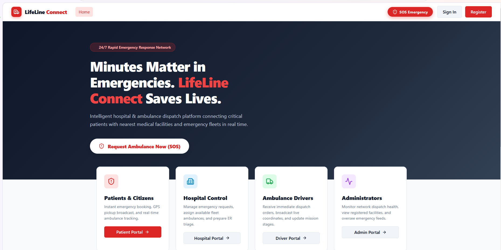
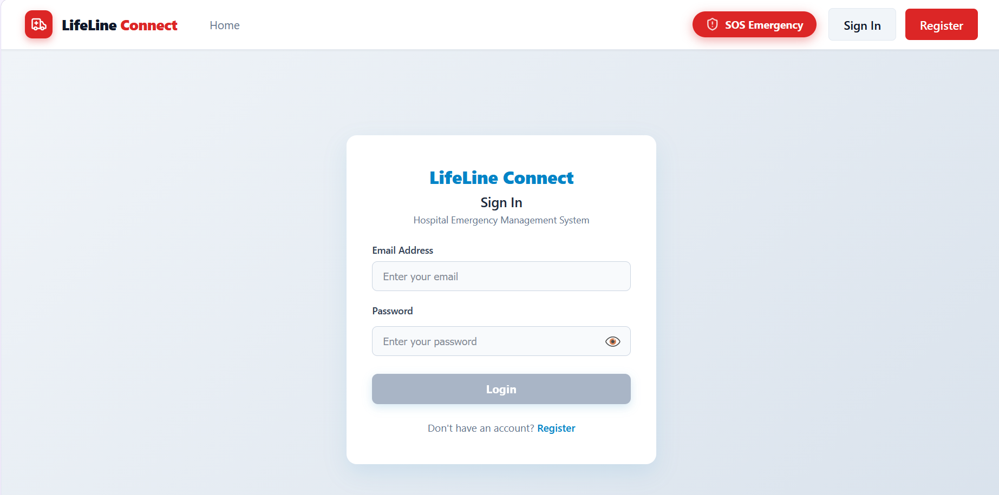
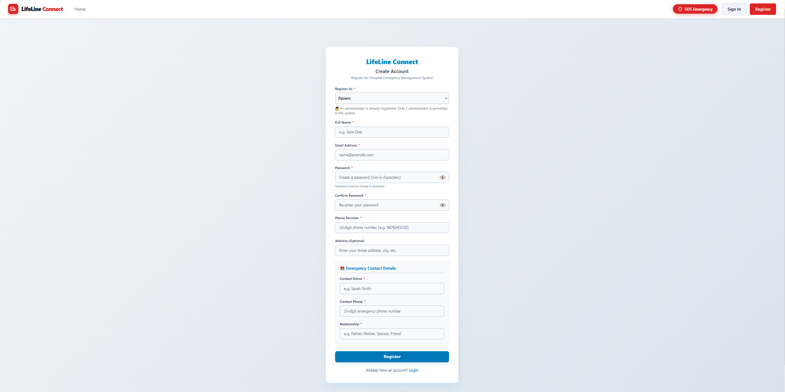
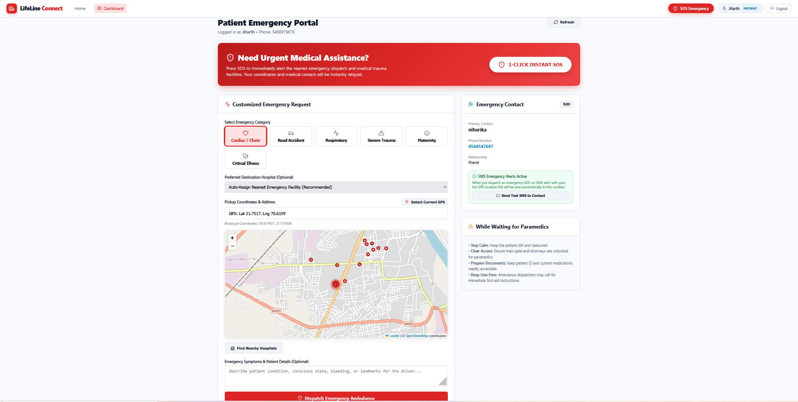
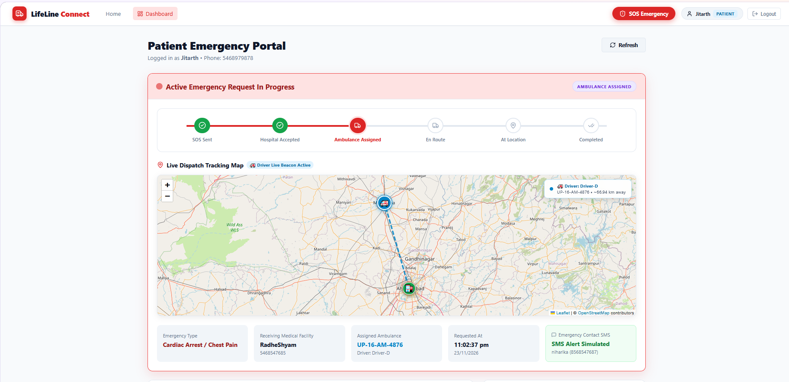
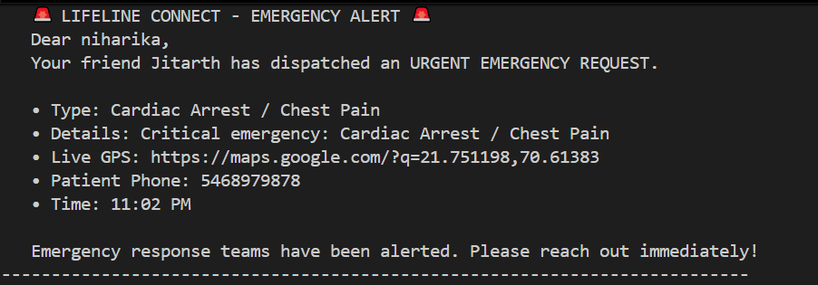
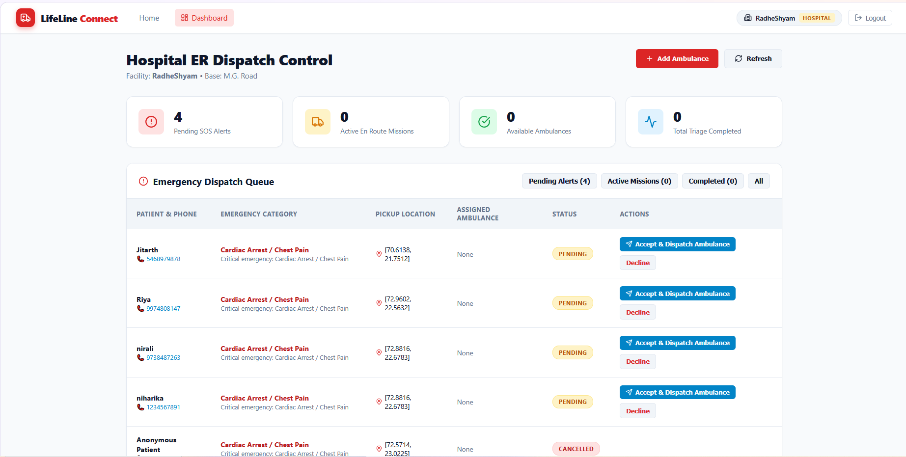
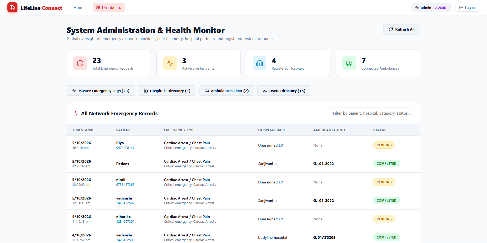

# 🚑 Lifeline Connect - Hospital Emergency Management System

[](https://reactjs.org/)
[](https://nodejs.org/)
[](https://expressjs.com/)
[](https://www.mongodb.com/)
[](https://leafletjs.com/)
[](https://www.twilio.com/)
[](https://opensource.org/licenses/MIT)

> **Lifeline Connect** is a full-stack emergency response and hospital management platform designed to save lives during critical medical situations. The system allows patients to request immediate emergency assistance, enables hospitals to accept requests and dispatch ambulances with live GPS tracking, notifies family members automatically via SMS alerts, and provides tailored dashboards for Admins, Hospitals, Ambulance Drivers, and Patients.

---

## 📌 Table of Contents

- [Overview](#-overview)
- [Key Features](#-key-features)
- [User Roles](#-user-roles)
- [Tech Stack](#-tech-stack)
- [Screenshots](#-screenshots)
- [Folder Structure](#-folder-structure)
- [Installation Guide](#-installation-guide)
- [Environment Variables](#-environment-variables)
- [How to Use the Project](#-how-to-use-the-project)
- [API Endpoints](#-api-endpoints)
- [Future Improvements](#-future-improvements)
- [Author](#-author)
- [License](#-license)

---

## 📖 Overview

In medical emergencies, every second counts. Traditional coordination between patients, ambulances, and hospital staff often suffers from communication delays and lack of real-time visibility.

**Lifeline Connect** solves this problem by connecting all four stakeholders on a single unified platform:

- Patients can trigger an emergency SOS with their GPS coordinates and medical details.
- Nearest hospitals can review the request, accept it, and dispatch available ambulances.
- Ambulance drivers receive immediate turn-by-turn routing and can update live transit statuses.
- Patient emergency contacts automatically receive an instant SMS notification with emergency details.

---

## ✨ Key Features

- **🚨 One-Click Emergency SOS**: Patients can quickly submit an emergency request with auto-detected GPS coordinates, triage urgency level, and medical notes.
- **📲 Automated SMS Family Alerts**: Powered by Twilio, emergency contacts receive an instant SMS alert the moment a patient raises an emergency request.
- **🗺️ Live GPS & Interactive Maps**: Integrated with Leaflet and OpenStreetMap for real-time tracking of patients, hospitals, and ambulances.
- **🚑 Intelligent Ambulance Dispatch**: Hospitals can view real-time ambulance availability and dispatch the nearest unit with a single click.
- **🔄 Live Status Pipeline**: Real-time status progression through all emergency stages: `Pending` ➔ `Accepted` ➔ `Ambulance Assigned` ➔ `On The Way` ➔ `Reached Patient` ➔ `Completed`.
- **🔐 Secure Role-Based Authentication**: Strict JWT-based authentication and role-based access control (RBAC) protecting each portal.
- **📊 Admin Analytics & Monitoring**: Central administrative control center to manage hospitals, view system-wide emergency logs, verify medical staff, and monitor ambulance fleets.

---

## 👥 User Roles

| Role                        | Access & Capabilities                                                                                                              |
| :-------------------------- | :--------------------------------------------------------------------------------------------------------------------------------- |
| **Admin**                   | Full system overview, hospital verification, ambulance fleet monitoring, user management, and operational analytics.               |
| **Hospital Staff / Doctor** | Accept or reject incoming emergency requests, assign ambulances, monitor patient triage levels, and manage hospital capacity.      |
| **Ambulance Driver**        | Receive dispatch notifications, view patient location coordinates, navigate route, and update trip progress.                       |
| **Patient**                 | Raise emergency requests, view nearby hospitals, track assigned ambulance on map, and configure emergency contacts for SMS alerts. |

---

## 🛠️ Tech Stack

### Frontend

- **React.js (v19)** – Modern component-based user interface
- **Vite** – Next-generation fast frontend build tool and development server
- **React Router (v7)** – Client-side routing and protected role-based page navigation
- **Leaflet & React-Leaflet** – Interactive maps and real-time geospatial coordinate visualization
- **Lucide React** – Clean, modern icon set
- **Axios** – Promise-based HTTP client for API requests
- **Custom CSS Design System** – Responsive, clean, accessible healthcare theme

### Backend

- **Node.js** – Server-side JavaScript runtime environment
- **Express.js (v5)** – RESTful API web framework
- **MongoDB & Mongoose (v9)** – NoSQL database with geospatial (`2dsphere`) indexing
- **JSON Web Tokens (JWT)** – Stateless authentication and authorization
- **Bcrypt.js** – Secure password hashing
- **Twilio SDK** – SMS service for instant emergency contact dispatch notifications
- **CORS & Dotenv** – Cross-origin resource sharing and environment management

---

## 📸 Screenshots

> Put your screenshot images inside the `screenshots/` folder in the root directory.

| View                                                                                                        | Screenshot                                                                                                                                     |
| :---------------------------------------------------------------------------------------------------------- | :--------------------------------------------------------------------------------------------------------------------------------------------- |
| **Home Page**<br>Home page for portal                                                                       | <br><sub>_Figure 1:Unified home page_</sub>                                                                 |
| **Login Page**<br>Secure authentication for all roles                                                       | <br><sub>_Figure 2:Unified role-based login portal_</sub>                                                  |
| **Registration**<br>Triage details & emergency contacts                                                     | <br><sub>_Figure 3: Patient,ambulance driver and hospital onboarding and emergency details_</sub> |
| **Patient Dashboard**<br>Send Emergency request to hospitals                                                | <br><sub>_Figure 4: Patient's reuest status and live ambulance tracker_</sub>                          |
| **Patient Dashboard after accepting request by hospital**<br>Patient tracking live GPS location of ambulace | <br><sub>_Figure 5: Patient's reuest status and live ambulance tracker_</sub>                         |
| **Notification to Emergency contact**<br>Send Emergency notification of patient to emergency contacts       | <br><sub>_Figure 6: Patient's emergency notification to emergency contact_</sub>         |
| **Hospital Emergency Dashboard**<br>Manage incoming requests & dispatch                                     | <br><sub>_Figure 7: Hospital live queue and ambulance dispatch_</sub>                           |
| **Ambulance Driver & Live Map**<br>GPS tracking & trip progress                                             | <br><sub>_Figure 8: Live GPS location tracking and route management_</sub>                        |
| **Admin Dashboard**<br>System overview & fleet stats                                                        | <br><sub>_Figure 9: Admin analytics and resource monitoring_</sub>                                    |

---

## 📁 Folder Structure

```text
Lifeline_Connect/
├── backend/
│   ├── config/             # Database connection and setup (MongoDB / Atlas)
│   ├── Controllers/        # Business logic (Auth, Emergency, Ambulance, Hospital, SMS)
│   ├── middleware/         # JWT authentication and role-checking middleware
│   ├── models/             # Mongoose schemas (User, Hospital, Ambulance, EmergencyRequest)
│   ├── routes/             # Express API routes
│   ├── services/           # External integrations (Twilio SMS notification service)
│   └── app.js              # Express app configuration and middleware setup
├── frontend/
│   ├── public/             # Static public assets
│   ├── src/
│   │   ├── components/     # Reusable components (Navbar, Modals, Map views)
│   │   ├── context/        # React context providers (AuthContext, etc.)
│   │   ├── pages/          # Page views (Admin, Hospital, Driver, Patient dashboards)
│   │   ├── services/       # Frontend API communication layer
│   │   ├── App.jsx         # App router and layout definitions
│   │   ├── main.jsx        # React application entry point
│   │   └── dashboard.css   # Main dashboard and UI styling
│   ├── index.html          # HTML entry point
│   └── vite.config.js      # Vite configuration
├── screenshots/            # Showcase images for documentation
├── .env.example            # Example configuration for environment variables
├── package.json            # Backend scripts and root dependencies
├── server.js               # Main server startup script
└── README.md               # Project documentation
```

---

## ⚙️ Installation Guide

Follow these simple steps to run the project on your local machine.

### Prerequisites

Make sure you have the following installed on your computer:

- [Node.js](https://nodejs.org/) (version 18 or higher)
- [Git](https://git-scm.com/)
- [MongoDB](https://www.mongodb.com/) (Local Community Server or MongoDB Atlas cloud account)

---

### Step 1: Clone the Repository

Open your terminal or command prompt and run:

```bash
git clone https://github.com/your-username/hospital-emergency-management-system.git
cd hospital-emergency-management-system/Lifeline_Connect
```

---

### Step 2: Install Server Dependencies

Install the backend packages:

```bash
npm install
```

---

### Step 3: Install Frontend Dependencies

Move into the `frontend` folder and install client packages:

```bash
cd frontend
npm install
cd ..
```

---

### Step 4: Configure Environment Variables

In the `Lifeline_Connect` folder, make a copy of `.env.example` named `.env`:

```bash
# On Windows PowerShell:
Copy-Item .env.example .env

# On Mac / Linux / Bash:
cp .env.example .env
```

Open `.env` in your text editor and add your values:

```env
PORT=5000
MONGO_URI=mongodb+srv://<username>:<password>@cluster.mongodb.net/lifeline_connect
LOCAL_MONGO_URI=mongodb://127.0.0.1:27017/lifeline_connect
JWT_SECRET=your_super_secret_jwt_key

# Twilio SMS Configuration (Optional for SMS alerts)
TWILIO_ACCOUNT_SID=your_twilio_account_sid
TWILIO_AUTH_TOKEN=your_twilio_auth_token
TWILIO_PHONE_NUMBER=your_twilio_phone_number
DEFAULT_COUNTRY_CODE=+91
```

> **Note:** If you don't have Twilio credentials yet, the application automatically runs SMS notifications in **simulated mode** so you can test without any errors.

---

### Step 5: Run the Project

You can run both server and client together or in separate terminals.

#### Option A: Run Backend Server

In the root `Lifeline_Connect` directory:

```bash
npm run dev
```

_Backend will run at: `http://localhost:5000`_

#### Option B: Run Frontend Client

In a new terminal window, navigate to the `frontend` folder:

```bash
cd frontend
npm run dev
```

_Frontend will run at: `http://localhost:5173`_

Open your browser and visit: `http://localhost:5173`

---

## 🔐 Environment Variables

Here is a list of variables required to configure the application:

| Variable Name          | Purpose                                                  | Example / Format                |
| :--------------------- | :------------------------------------------------------- | :------------------------------ |
| `PORT`                 | The port number on which the backend server runs         | `5000`                          |
| `MONGO_URI`            | Cloud connection URI for MongoDB Atlas                   | `mongodb+srv://...`             |
| `LOCAL_MONGO_URI`      | Local MongoDB fallback connection string                 | `mongodb://127.0.0.1:27017/...` |
| `JWT_SECRET`           | Secret key used to encrypt and verify user tokens        | `your_secret_token`             |
| `TWILIO_ACCOUNT_SID`   | Account SID from your Twilio Console                     | `ACxxxxxxxxxxxxxxxx`            |
| `TWILIO_AUTH_TOKEN`    | Auth Token from your Twilio Console                      | `your_auth_token`               |
| `TWILIO_PHONE_NUMBER`  | Sender phone number provided by Twilio                   | `+1xxxxxxxxxx`                  |
| `DEFAULT_COUNTRY_CODE` | Default country dialing code for emergency phone numbers | `+91`                           |

---

## 🚀 How to Use the Project

### 1. Patient Flow

1. Sign up as a **Patient** and add your emergency contact's phone number.
2. From the Patient Dashboard, select the emergency type (e.g., Cardiac, Trauma, Respiratory) and click **Request Emergency Assistance**.
3. Your live GPS coordinates are recorded, the nearest hospitals are notified, and an automated SMS is dispatched to your emergency contact.
4. Track the ambulance assigned to you on the live Leaflet map.

### 2. Hospital Flow

1. Log in with your **Hospital** account.
2. View incoming emergency requests in real time.
3. Review patient details and click **Accept & Assign Ambulance**.
4. The system matches the nearest available ambulance in your fleet and dispatches the unit.

### 3. Driver Flow

1. Log in as an **Ambulance Driver**.
2. See your assigned emergency mission with the patient's coordinates and medical note.
3. Update your trip status as you progress: `On The Way` ➔ `Reached Patient` ➔ `Completed`.

### 4. Admin Flow

1. Log in as an **Admin**.
2. View comprehensive statistics: total registered hospitals, available ambulance units, and total emergencies handled.
3. Verify newly registered hospitals and manage user accounts across the system.

---

## 📡 API Endpoints

### 🔑 Authentication Routes (`/api/auth`)

| Method | Endpoint                 | Description                                                    | Access |
| :----- | :----------------------- | :------------------------------------------------------------- | :----- |
| `POST` | `/api/auth/register`     | Register a new user (Patient, Hospital, Driver, Admin)         | Public |
| `POST` | `/api/auth/login`        | Authenticate user and return JWT token                         | Public |
| `GET`  | `/api/auth/admin-exists` | Check if an administrator account has already been initialized | Public |

### 🚨 Emergency Routes (`/api/emergencies`)

| Method | Endpoint                                 | Description                                          | Access            |
| :----- | :--------------------------------------- | :--------------------------------------------------- | :---------------- |
| `POST` | `/api/emergencies`                       | Create a new emergency SOS request                   | Patient           |
| `GET`  | `/api/emergencies`                       | Retrieve list of emergencies (with status filters)   | Authenticated     |
| `GET`  | `/api/emergencies/:id`                   | Fetch emergency details by ID                        | Authenticated     |
| `PUT`  | `/api/emergencies/:id/accept-and-assign` | Accept emergency request & auto-assign ambulance     | Hospital          |
| `PUT`  | `/api/emergencies/:id/status`            | Update trip status (`on_the_way`, `completed`, etc.) | Driver / Hospital |
| `PUT`  | `/api/emergencies/:id/cancel`            | Cancel an emergency request                          | Patient / Admin   |

### 🚑 Ambulance Routes (`/api/ambulances`)

| Method | Endpoint                       | Description                                            | Access            |
| :----- | :----------------------------- | :----------------------------------------------------- | :---------------- |
| `GET`  | `/api/ambulances`              | Get all ambulances (supports `?status=`, `?hospital=`) | Authenticated     |
| `POST` | `/api/ambulances`              | Register a new ambulance vehicle to a hospital fleet   | Hospital / Admin  |
| `GET`  | `/api/ambulances/:id`          | Get details and status of a single ambulance           | Authenticated     |
| `PUT`  | `/api/ambulances/:id/status`   | Update ambulance status (`available`, `busy`, etc.)    | Driver / Hospital |
| `PUT`  | `/api/ambulances/:id/location` | Update live latitude & longitude coordinates           | Driver            |

### 🏥 Hospital Routes (`/api/hospitals`)

| Method | Endpoint                     | Description                                           | Access           |
| :----- | :--------------------------- | :---------------------------------------------------- | :--------------- |
| `GET`  | `/api/hospitals`             | List all verified hospitals with location data        | Public           |
| `GET`  | `/api/hospitals/profile/:id` | Get detailed profile of a hospital                    | Authenticated    |
| `PUT`  | `/api/hospitals/profile/:id` | Update hospital information and address               | Hospital / Admin |
| `GET`  | `/api/hospitals/emergencies` | Get emergency requests assigned to logged-in hospital | Hospital         |

### 💬 SMS Notification Routes (`/api/sms`)

| Method | Endpoint                      | Description                                      | Access           |
| :----- | :---------------------------- | :----------------------------------------------- | :--------------- |
| `GET`  | `/api/sms/config-status`      | Check if Twilio is active or in simulation mode  | Authenticated    |
| `POST` | `/api/sms/test`               | Send a test SMS to an emergency contact number   | Authenticated    |
| `POST` | `/api/sms/resend/:id`         | Resend SMS alert for an active emergency request | Hospital / Admin |
| `GET`  | `/api/sms/history/:patientId` | View history of SMS alerts sent for a patient    | Authenticated    |

---

## 🔮 Future Improvements

- [ ] **WebSockets / Socket.io**: Real-time two-way communication for instantaneous notifications without polling.
- [ ] **Turn-by-turn Navigation**: In-app routing directions for ambulance drivers using OpenStreetMap / Mapbox directions API.
- [ ] **AI-Powered Triage Assistant**: Pre-triage assessment chatbot to evaluate symptoms and suggest emergency severity.
- [ ] **Hospital Bed Availability Tracking**: Real-time ICU and oxygen bed availability indicators.
- [ ] **Mobile App**: Cross-platform React Native app for mobile push alerts and offline emergency SOS.

---

## 👨‍💻 Author

**Your Name**

- GitHub: [Niharika-Sondagar](https://github.com/Niharika-Sondagar)
- LinkedIn: [](https://linkedin.com/in/your-profile)
- Email: `ngirishbhaisondagar026@gmail.com`

---

<p align="center">
  Made with ❤️ to help save lives during medical emergencies.
</p>
